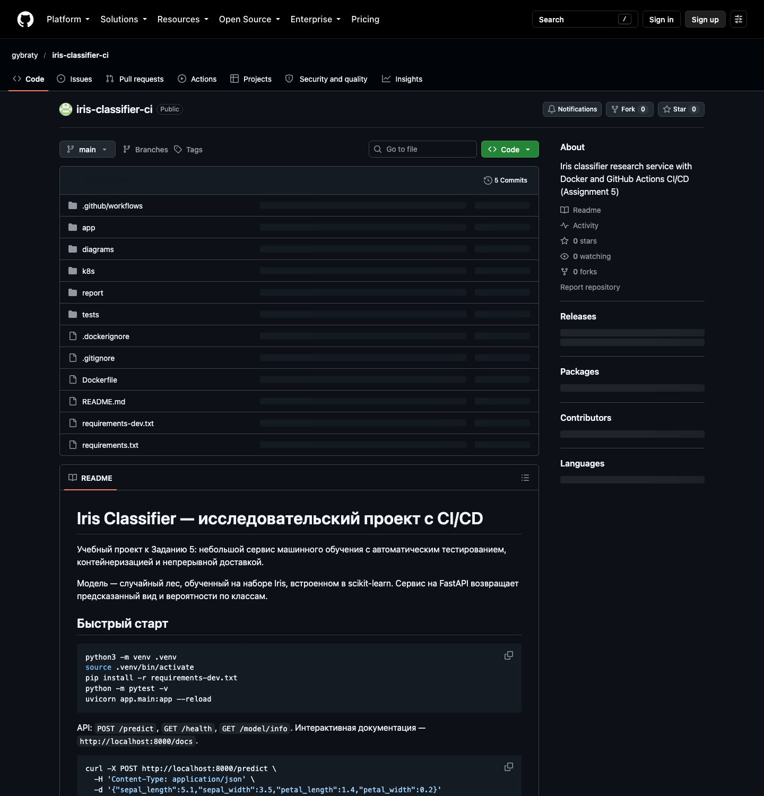
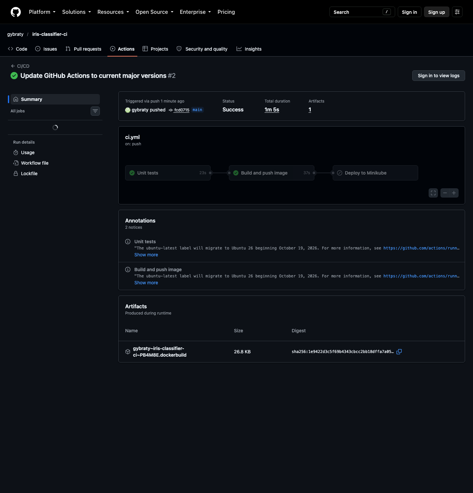
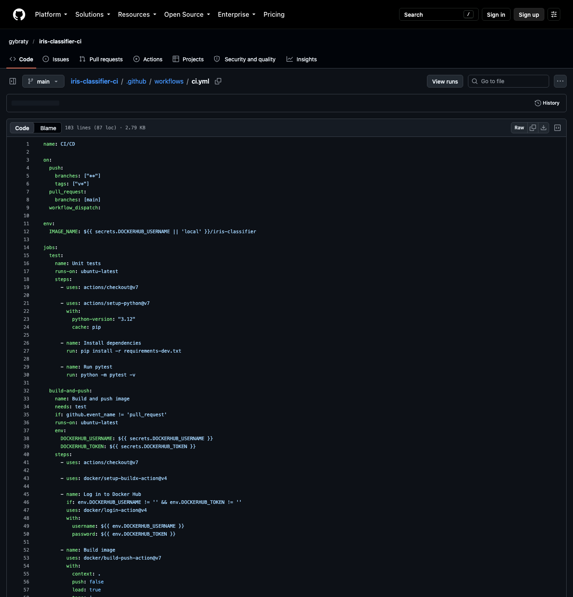

# Часть 2 — Практический отчёт: CI/CD-конвейер для классификатора ирисов

Автор: gybraty
Репозиторий: https://github.com/gybraty/iris-classifier-ci
Дата: 28 октября 2026

## 1. Проект

Сервис классифицирует цветы ириса на три вида по четырём измерениям. Модель —
случайный лес из scikit-learn на встроенном наборе Iris, seed 42, стратифицированное
разбиение 80/20; доступ через REST API на FastAPI. Jenkins заменён на GitHub
Actions (разрешено заданием): workflow выполняет роль `Jenkinsfile` с теми же
стадиями.

```
app/model.py, app/main.py    классификатор и API (/predict, /health, /model/info)
tests/                       11 тестов: точность, предсказания, контракт HTTP
Dockerfile, .github/, k8s/   образ, конвейер, манифесты развёртывания
```

## 2. Начальная настройка и проверка

```bash
python3 -m venv .venv && source .venv/bin/activate
pip install -r requirements-dev.txt && python -m pytest -v
```

Результат: **11 тестов пройдено**, **точность 0,900** на 30 отложенных примерах
(120 — обучение).

## 3. Контейнеризация

Образ `python:3.12-slim`; зависимости ставятся до копирования кода, поэтому кеш
слоёв переиспользуется; копируется только `app/`; процесс работает под
пользователем `appuser` (UID 10001); `HEALTHCHECK` вызывает `GET /health`.

```bash
docker build -t iris-classifier:local .
docker run --rm -p 8000:8000 iris-classifier:local
```

Проверено: `/health` вернул 200, `/predict` — `setosa` с уверенностью 1.0,
`/model/info` — точность 0.9; размер образа 123 МБ.

## 4. CI-конвейер в GitHub Actions

**`test`** запускается на каждом push в любую ветку и на PR в `main`, ставит
Python 3.12 с кешем pip и выполняет `python -m pytest -v`.

**`build-and-push`** собирает образ через Buildx и запускает контейнер,
проверяя `/health` (smoke-тест). Образ получает теги по хешу коммита и `latest`.
Публикация в Docker Hub выполняется только при заданных секретах
`DOCKERHUB_USERNAME` и `DOCKERHUB_TOKEN` и ветке `main` либо теге `v*`; иначе
образ собирается и тестируется без публикации, поэтому PR и форки работают без
учётных данных.

**`deploy`** — опциональная CD-стадия: ручной запуск при переменной
`ENABLE_CD=true` на self-hosted раннере с меткой `minikube`. Применяет `k8s/`,
обновляет образ до хеша коммита и ждёт `kubectl rollout status`.

Секреты: `DOCKERHUB_USERNAME`, `DOCKERHUB_TOKEN` (access token); для CD —
раннер и `ENABLE_CD=true`.

## 5. Развёртывание

`k8s/deployment.yaml` — две реплики с пробами readiness и liveness на `/health` и
лимиты ресурсов. `k8s/service.yaml` публикует сервис на NodePort 30080.

```bash
minikube start && kubectl apply -f k8s/
minikube image load iris-classifier:local
```

## 6. Сложности

1. **Версии окружений.** Локально Python 3.14, в CI и образе — 3.12; точные
   версии в requirement-файлах устранили различия.
2. **Точность на границе.** При 30 примерах один неверный прогноз меняет точность
   на 3,3 п.п.; seed фиксирован, тест проверяет порог 0,85.
3. **Секреты в CI.** GitHub Actions не поддерживает секреты в условиях `if:`;
   они присваиваются переменным уровня задания.
4. **Доступность кластера.** Раннеры GitHub не видят API Minikube, поэтому deploy
   вынесен на self-hosted раннер и запускается вручную.

## 7. Выводы

Конвейер автоматизирует запуск тестов, сборку образа и доставку в реестр или
кластер; каждый артефакт прослеживается до коммита. Главный вывод: дорогая часть —
не YAML, а определение «правильного» поведения численной модели.

## Приложение А. Скриншоты

{width=70%}

{width=70%}

{width=70%}

Дополнительно после настройки секретов и кластера снять: теги образа на Docker
Hub (`04-dockerhub.png`), `kubectl get pods,svc -n iris` (`05-kubectl.png`), ответ
`curl /predict` (`06-api.png`), красный запуск со сломанным тестом
(`07-failed-run.png`).
