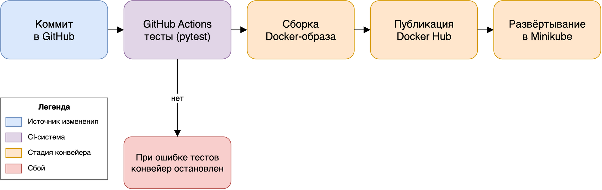
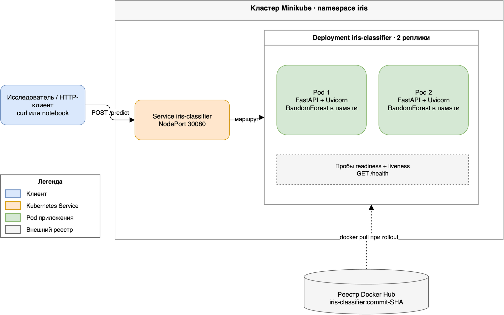

# Роль DevOps и CI/CD в автоматизации исследовательских проектов

**Практический пример: сервис классификации ирисов с конвейером на Docker и GitHub Actions**

Автор: <Ваше имя>
Курс: DevOps и CI/CD: автоматизация процессов для исследовательских проектов
Задание 5 — Часть 1 (теоретическая работа)
Дата: <дата сдачи>

---

## Введение

Исследовательское программное обеспечение создаётся в условиях, заметно
отличающихся от коммерческой разработки: небольшие команды, короткое время
жизни проекта, меняющиеся наборы данных и жёсткие сроки публикации. Код, на
котором основан опубликованный результат, должен запускаться через годы, на
другой машине и у человека, который его не писал. Это требование близко к
задачам, для которых создавались практики DevOps, хотя мотивация и терминология
различаются. В отчёте рассматривается роль DevOps и CI/CD в автоматизации
исследовательских проектов; аргументы иллюстрируются конвейером из Части 2 —
моделью классификации ирисов, упакованной в Docker и автоматически проверяемой
в GitHub Actions.

## 1. Что такое DevOps: цели, принципы и преимущества

DevOps — набор практик, устраняющих организационный барьер между разработкой
(Dev) и эксплуатацией (Ops) и заменяющих его общей ответственностью за
жизненный цикл системы. Цель — не конкретный инструмент, а поток: небольшие
изменения доставляются часто, проверяются автоматически и наблюдаемы в работе.
Модель CALMS сводит принципы к культуре, автоматизации, бережливости (Lean),
измерениям и обмену знаниями. Не менее известна формулировка «трёх путей»
Хамбла и Фарли: оптимизировать поток работы от идеи до пользователя, сокращать и
усиливать обратную связь, развивать культуру непрерывного эксперимента
(Humble & Farley, 2010).

Для исследовательских команд отсюда следуют практические выгоды. Автоматизация
делает результаты воспроизводимыми: один и тот же коммит всегда проходит одни и
те же шаги. Быстрая обратная связь сокращает цикл от идеи до проверенного
результата. Измерения в метриках DORA — частота развёртываний, время выполнения
изменений, доля неудачных изменений и время восстановления — превращают
«конвейер кажется медленным» в число, которое можно улучшить (Forsgren,
Humble & Kim, 2018). Наконец, автоматизация под контролем версий служит
документацией, которая не устаревает молча, — это важно, когда студент уходит, а
научный руководитель должен воспроизвести работу.

## 2. Обзор CI/CD

Continuous Integration (CI) означает, что каждое изменение часто вливается в
общую ветку и проверяется автоматически. Конвейер получает код, устанавливает
зависимости, запускает тесты и в исследовательских проектах часто воспроизводит
эталонный результат. Continuous Delivery расширяет это, поддерживая каждый
успешный сбор в состоянии, готовом к выпуску; Continuous Deployment идёт дальше
и выпускает каждый успешный сбор без ручного подтверждения.

Типичный конвейер показан на рисунке 1. Коммит запускает workflow; тесты идут
первыми, потому что они быстрые и дешёвые; только затем собирается артефакт.
Артефакт неизменяем и идентифицируется хешем коммита, поэтому любой
опубликованный результат можно проследить до точного кода. Сбой на любом этапе
блокирует слияние, и проверка кода превращается из вопроса мнений в вопрос
свидетельств.

{width=100%}

Модель реализуют Jenkins, GitLab CI, GitHub Actions, CircleCI и другие системы.
Выбор в основном организационный. Jenkins размещается на собственном сервере,
легко расширяется, но требует обслуживания сервера и плагинов. GitHub Actions
работает на предоставленных раннерах, описывается YAML-файлом в репозитории и не
требует собственной инфраструктуры, что разумно для студенческого проекта
(задание допускает такую замену по согласованию).

## 3. Роль DevOps-инструментов в исследовательской среде

Центральная проблема вычислительных исследований — разрыв воспроизводимости:
анализ работает на ноутбуке автора и падает на машине рецензента после
обновления библиотеки. Боттигер (2015) описал это как проблему
«исследовательского компендиума»: статья воспроизводима, только если код, данные
и вычислительная среда путешествуют вместе. DevOps-инструменты напрямую решают
часть этой задачи, связанную со средой.

Три свойства исследовательской работы делают такие инструменты особенно
ценными. Во-первых, среда дрейфует: системные библиотеки, драйверы CUDA и пакеты
Python меняются независимо, а файл зависимостей без зафиксированных версий не
является спецификацией. Образ контейнера фиксирует всё дерево зависимостей на
момент времени. Во-вторых, текучесть команд высока: студенты выпускаются, их
скрипты остаются, и конвейер, который новичок запускает одной командой, снижает
стоимость наследования проекта. В-третьих, научные утверждения требуют
проверяемости: дайджест образа, хеш коммита и лог конвейера вместе образуют
происхождение, которого не даёт папка скриптов.

Барьеры не менее реальны. Исследование часто поисковое, и первая версия анализа
может использоваться один раз; полный конвейер там избыточен. Автотесты требуют
определения правильного поведения, что для численного кода объективно сложно:
результат слегка меняется при другой реализации плавающей точки. Наконец,
исследовательские данные часто конфиденциальны или слишком велики для публичного
реестра, поэтому код и данные версионируются раздельно.

## 4. Примеры: Docker, Jenkins и Kubernetes в научных и инженерных проектах

**Docker.** Образ контейнера упаковывает приложение вместе с интерпретатором,
библиотеками и системными утилитами. Dockerfile при этом становится исполняемой
записью среды. Нюст и соавторы (2020) дают практические правила воспроизводимых
образов: фиксировать базовый образ и версии зависимостей, уменьшать размер, не
устанавливать лишние утилиты, помечать образы осмысленными тегами.
Инфраструктура исследований восприняла идею широко: Binder собирает образы из
Git-репозиториев через repo2docker, а платформы вроде Code Ocean и REANA
запускают опубликованные анализы в контейнерах. В практической части Dockerfile
начинается с `python:3.12-slim`, ставит зафиксированные зависимости, копирует
только код приложения, работает под непривилегированным пользователем и
объявляет healthcheck на `/health`.

**Jenkins.** Jenkins популяризировал pipeline-as-code через `Jenkinsfile`:
декларативный конвейер объявляет стадии (`Test`, `Build`, `Push`, `Deploy`),
сервер выполняет их на каждом коммите. Jenkins распространён в вычислительных
центрах университетов и долгих инженерных проектах, где собственный сервер,
тонкие права доступа и большая экосистема плагинов перевешивают расходы на
обслуживание. Его слабость — как раз обслуживание: обновления плагинов и образов
агентов становятся отдельным проектом. В этой работе вместо Jenkins используется
GitHub Actions; файл `.github/workflows/ci.yml` играет роль `Jenkinsfile` и
описывает те же стадии.

**Kubernetes.** Kubernetes распределяет контейнеры по кластеру, перезапускает
упавшие контейнеры, балансирует трафик между репликами и поддерживает rolling
update. В науке это основа Kubeflow и крупных вычислительных и ML-нагрузок. Для
небольшого исследовательского сервиса Minikube даёт одноузловой кластер,
достаточный для демонстрации модели развёртывания: Deployment с двумя репликами,
пробы readiness и liveness на `/health` и Service типа NodePort на порту 30080
(рисунок 2). Те же манифесты позже работают в управляемом кластере без изменений.

{width=80%}

Сравнение показывает, что инструменты решают разные слои одной задачи. Docker
определяет артефакт, CI-сервер (Jenkins или GitHub Actions) — процесс,
Kubernetes — среду исполнения. Команда может внедрять их независимо; практическая
ценность появляется, когда они образуют цепочку.

## 5. Заключение: какие проблемы DevOps решает в научных командах

DevOps не делает исследование более творческим, но устраняет класс отказов,
которые тратят время, не производя знания. Он решает проблему «работает на моей
машине», делая среду частью артефакта. Он снижает число ошибок ручного выпуска,
потому что шаги сборки и публикации существуют как версионируемый код, а не как
инструкция в README. Он делает результаты прослеживаемыми: каждый опубликованный
артефакт несёт хеш коммита. Он сокращает адаптацию новичка: среда воспроизводится
одной командой. И он делает качество видимым: в проекте из Части 2 на каждый push
запускаются одиннадцать автотестов, образ собирается и проходит smoke-тест до
публикации, а развёртывание проверяется пробами Kubernetes, а не открытием
браузера.

Границы следует назвать честно. Конвейер требует обслуживания, публичный реестр
не подходит для конфиденциальных данных, а численным исследованиям нужны тесты
свойств и допусков, а не точных значений. Эти издержки оправданы, когда ПО
переиспользуется, публикуется или поддерживается дольше одной статьи. Для
разового поискового скрипта — нет. Практический вывод для команды скромен, но
ясен: внедрять минимальный конвейер, покрывающий тесты и воспроизводимый образ, и
расширять его к доставке и развёртыванию по мере появления пользователей.

## Литература

1. Boettiger, C. (2015). An introduction to Docker for reproducible research. *ACM SIGOPS Operating Systems Review*, 49(1), 71–79.
2. Forsgren, N., Humble, J., & Kim, G. (2018). *Accelerate: The Science of Lean Software and DevOps*. IT Revolution Press.
3. Humble, J., & Farley, D. (2010). *Continuous Delivery: Reliable Software Releases through Build, Test, and Deployment Automation*. Addison-Wesley.
4. Nüst, D., Sochat, V., Marwick, B., Eglen, S. J., Head, T., Hirst, T., & Evans, B. D. (2020). Ten simple rules for writing Dockerfiles for reproducible data science. *PLOS Computational Biology*, 16(11), e1008316.
5. Docker Documentation. *Building best practices*. https://docs.docker.com/build/building/best-practices/
6. GitHub Documentation. *GitHub Actions documentation*. https://docs.github.com/en/actions
7. Kubernetes Documentation. *Deployments*. https://kubernetes.io/docs/concepts/workloads/controllers/deployment/
8. Kubernetes Documentation. *Configure Liveness, Readiness and Startup Probes*. https://kubernetes.io/docs/tasks/configure-pod-container/configure-liveness-readiness-startup-probes/
